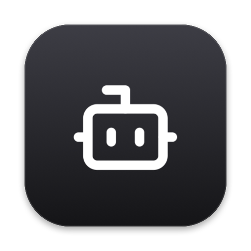
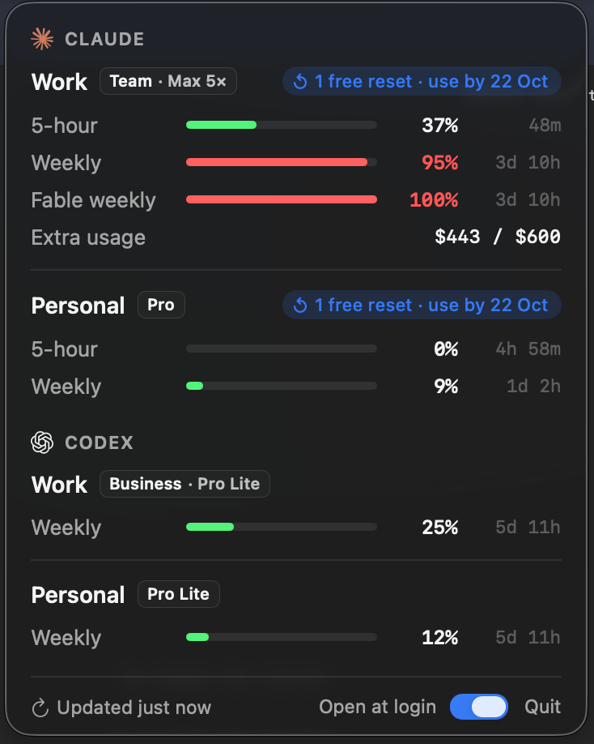
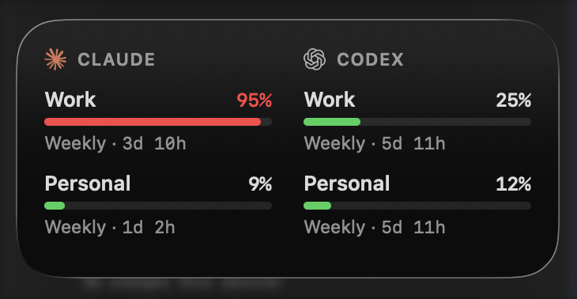

<p align="center">
  
</p>

<h1 align="center">Agent Usage</h1>

A macOS menu bar app and widget that show your **Claude Code** and **Codex**
usage limits — every subscription, side by side — and when each one resets.

<p>
  
  
</p>

- **Grouped by provider, then profile.** Each profile shows its plan (Team ·
  Max 5×, Pro, Pro Lite…), any free usage-limit resets with their use-by date,
  and one row per limit — 5-hour, weekly, model-specific (Fable) — with time
  until it resets, plus extra-usage spend.
- **Widget** in small, medium and large sizes, for Notification Center or the
  desktop. Edit it to choose which profiles it shows.
- **Any number of subscriptions.** Add a Claude or Codex login by pointing at
  its folder, and sign in from the app.
- **Extra-usage alert.** The menu bar icon turns orange (your choice of
  colour) while a Claude account is past a limit and billing extra usage.

You need macOS 14 or later, plus the [Claude Code](https://code.claude.com)
and/or [Codex](https://github.com/openai/codex) CLI for each provider you use.

## Install

### Download (no widget)

Each [release](https://github.com/insanoid/agent-usage-ai/releases) has a
ready-built `AgentUsage-<version>-no-widget.zip`. It is ad-hoc signed — signed,
but not by an Apple-registered developer, and not notarized — so macOS asks
once before opening it:

1. Unzip it and move **AgentUsage.app** to `~/Applications` (or `/Applications`).
2. Double-click it. macOS says it cannot verify the developer; click **Done**.
3. Open **System Settings → Privacy & Security**, scroll to *Security*, click
   **Open Anyway** next to Agent Usage, and confirm.

   Or, in Terminal: `xattr -dr com.apple.quarantine ~/Applications/AgentUsage.app`

4. Agent Usage reads usage with Python 3, which comes with Apple's command
   line tools. If it says Python is missing, run `xcode-select --install`.

The downloaded build has no widget: widgets only load in an app signed with a
developer team. Build from source to get it.

### Build from source (with the widget)

You need [Xcode](https://apps.apple.com/app/xcode/id497799835) (open it once
after installing) and [Homebrew](https://brew.sh). Then:

```sh
git clone https://github.com/insanoid/agent-usage-ai && cd agent-usage-ai && ./scripts/install.sh
```

The script checks your tools, installs `xcodegen` if needed, builds the app,
signs it, copies it to `~/Applications` and starts it. Look for the robot in
the menu bar. To update later: `git pull && ./scripts/install.sh`.

## Build, sign and deploy on your Mac

`install.sh` does all of this; these are the steps it runs, for when you want
control.

**1. Pick how to sign.** Two environment variables decide it:

| Variable | Meaning |
|----------|---------|
| `AGENT_USAGE_TEAM` | Your Apple Development team ID — the *OU* of your "Apple Development" certificate in Keychain Access. Set it to sign with your team, which includes the widget. Set it **empty** to sign ad-hoc (self-signed), with no widget. |
| `AGENT_USAGE_BUNDLE_PREFIX` | A reverse-DNS prefix you own, such as `com.yourname`. Bundle IDs and the widget's App Group derive from it. |

A free Apple ID works for team signing: Xcode → Settings → Accounts → add it.
Xcode then creates the "Apple Development" certificate for you.

**2. Build and install.**

```sh
# Signed with your team, widget included
AGENT_USAGE_TEAM=ABCDE12345 AGENT_USAGE_BUNDLE_PREFIX=com.yourname ./scripts/build-app.sh --install

# Self-signed (ad-hoc), no widget, no Apple ID needed
AGENT_USAGE_TEAM= AGENT_USAGE_BUNDLE_PREFIX=com.yourname ./scripts/build-app.sh --install
```

`build-app.sh` generates the Xcode project from `project.yml`, builds a Release
copy in `build/`, signs it (ad-hoc builds drop the widget and are re-signed
with `codesign --sign -`), and with `--install` copies it to `~/Applications`
and restarts it. Turn on **Open at login** in Settings.

**3. Package for someone else.**

```sh
./scripts/package.sh    # → dist/AgentUsage-<version>[-no-widget].zip and .sha256
```

It builds with the same variables, then zips the app with `ditto`, which keeps
the signature intact. Neither signing mode is notarized, so whoever downloads
it needs the **Open Anyway** step above. A build signed with your team may run
on another Mac, but only notarization — which needs a paid Apple Developer
Program membership and a Developer ID certificate — makes it open without
that step.

**4. Publish a release.** Push a version tag; GitHub Actions
([`.github/workflows/release.yml`](.github/workflows/release.yml)) runs the
tests, packages an ad-hoc build and publishes it as a release:

```sh
git tag v0.3.0 && git push origin v0.3.0
```

Running the workflow by hand (Actions → Release → Run workflow) only uploads
the zip as a build artifact. To add a team-signed build to a release from your
Mac: `./scripts/package.sh && gh release upload v0.3.0 dist/AgentUsage-0.3.0.zip*`.

## Set up your subscriptions

Click the robot, then the gear. Each **subscription** is a provider and the
folder its login lives in:

| Provider | Folder | Default |
|----------|--------|---------|
| Claude Code | `CLAUDE_CONFIG_DIR` | `~/.claude` |
| Codex | `CODEX_HOME` | `~/.codex` |

Give subscriptions the same name to show them together — "Work" on Claude and
"Work" on Codex form one Work profile. **Log in** runs `claude auth login` or
`codex login` for that folder and opens your browser to sign in.

The first run starts from [`config/subscriptions.json`](config/subscriptions.json),
which doubles as a sample: four folders, no credentials.

```json
{
  "version": 1,
  "subscriptions": [
    { "name": "Work", "provider": "claude", "dir": "~/.claude-work" },
    { "name": "Personal", "provider": "claude", "dir": "~/.claude" },
    { "name": "Work", "provider": "codex", "dir": "~/.codex-work" },
    { "name": "Personal", "provider": "codex", "dir": "~/.codex" }
  ]
}
```

Your copy lives in `~/Library/Application Support/AgentUsage/subscriptions.json`;
edit it in the app or by hand.

## How it works

The app runs the bundled [`bin/agent-usage`](bin/agent-usage) script every five
minutes (and when you open the panel, if the numbers are over a minute old)
with `/usr/bin/python3`, which Xcode provides. The script reads each login's
token, asks Anthropic and OpenAI for the limits, and prints JSON. It also works
on its own in a terminal:

```sh
bin/agent-usage --config config/subscriptions.json          # a table
bin/agent-usage --config config/subscriptions.json --json   # what the app reads
```

- **Claude:** reads the OAuth token Claude Code keeps in the Keychain, then
  calls `api.anthropic.com/api/oauth/usage` and `/api/oauth/profile`. Free
  resets and plan details come from undocumented parts of that API; if they
  change, only those details disappear. The plan is cached for a day in
  `~/.cache/agent-usage/`.
- **Codex:** runs `codex app-server` per folder and asks it for the account's
  rate limits, the same numbers the Codex TUI shows.
- **Credentials are only read, never written or sent anywhere else.** An idle
  Claude login's token expires after a few hours; using Claude Code with that
  folder refreshes it.
- **The widget** is sandboxed and cannot run the script, so the app writes
  each report to a shared App Group container and reloads the widget.
- **When a read fails** (for example a rate limit), the panel keeps the
  previous numbers and marks the profile with ⚠︎; hover it for the error.

## Develop

```sh
swift test                                  # unit tests, no Xcode project needed
AGENT_USAGE_LIVE=1 swift test               # also run the real script against your logins
swiftformat Sources Tests App && swiftlint lint Sources Tests App
./scripts/build-app.sh --install            # rebuild and restart
```

| Path | What |
|------|------|
| `bin/agent-usage` | The usage script the app bundles. |
| `config/subscriptions.json` | Default and sample subscriptions. |
| `Sources/AgentUsageCore` | Report model, script runner, store, caches, subscriptions. No UI. |
| `Sources/AgentUsageUI` | Views shared by the panel and the widget: rows, bars, type and spacing, logos. |
| `App/AgentUsage` | The menu bar app and its settings window. |
| `App/AgentUsageWidget` | The WidgetKit extension. |
| `project.yml` | XcodeGen spec; the `.xcodeproj` is generated, not committed. |
| `scripts/` | `install.sh` (one command), `build-app.sh`, `package.sh`, and `make-icon.swift`, which draws the app icon. |
| `.github/workflows/release.yml` | Tagged releases: test, package ad-hoc, publish. |

`scripts/build-app.sh` takes the signing team and bundle-ID prefix from
`AGENT_USAGE_TEAM` and `AGENT_USAGE_BUNDLE_PREFIX`; `install.sh` works both out
from your Keychain. Logs: `/usr/bin/log show --last 10m --info --predicate 'subsystem == "com.karthikeyaudupa.agent-usage"'`.

Provider marks: LobeHub Icons (MIT). Robot: Lucide (ISC). See
[`Sources/AgentUsageUI/Resources/ATTRIBUTION.md`](Sources/AgentUsageUI/Resources/ATTRIBUTION.md).
